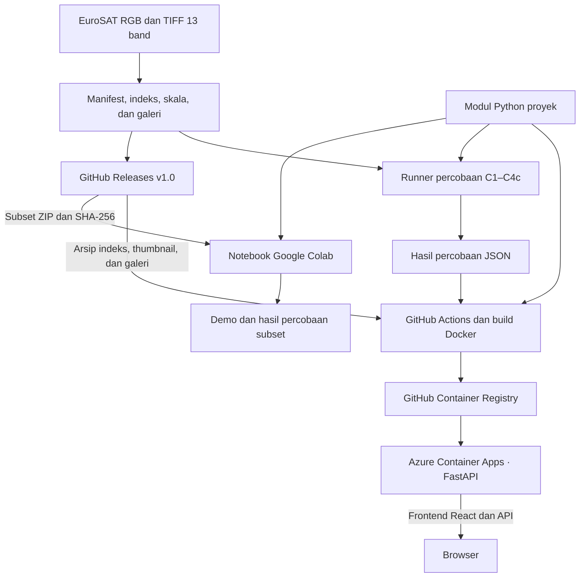

<p align="center"></p>
<h1 align="center">CitraSatelit</h1>
<p align="center">Laboratorium interaktif EuroSAT untuk pencarian citra berbasis konten, analisis multispektral, dan berbagi rahasia XOR.</p>
<p align="center"><a href="https://citrasatelit.blueisland-248683e9.indonesiacentral.azurecontainerapps.io">Aplikasi Web Azure</a> · <a href="https://colab.research.google.com/github/AryaLaniRiyongganiNurdian/CitraSatelit/blob/main/notebooks/citrasatelit.ipynb">Google Colab</a></p>

## Alur Kerja Aplikasi

**CBIR dan Inspektor Matematika.** Pilih citra EuroSAT atau unggah citra. CBIR membentuk fitur histogram atau momen, mengurutkan tetangga dengan metrik yang sesuai, dan menghitung Precision@k jika kelas kueri diketahui. Inspektor menampilkan rumus, substitusi angka, dan langkah perhitungan. Panel Bayes memperbarui peluang kelas dari bukti intensitas atau spektral. [Inti CBIR](src/core/cbir.py) · [API CBIR](src/api/routers/cbir.py) · [Inspektor](frontend/src/components/inspector-view.tsx)

**Analisis multispektral NDVI dan NDWI.** Dari TIFF 13 band, NDVI memakai B08 dan B04, sedangkan NDWI memakai B03 dan B08. Peta hasil dapat ditampilkan sebagai pratinjau atau dipakai sebagai fitur CBIR. Di deployment, pratinjau piksel multispektral tersedia untuk citra galeri dan unggahan TIFF. Pencarian memakai fitur prahitung untuk seluruh indeks. [Fungsi spektral](src/core/spectral.py) · [API pratinjau](src/api/routers/images.py)

**Berbagi rahasia XOR dan simulasi keamanan.** Pecah citra menjadi beberapa share dan gabungkan semuanya untuk mengembalikan piksel asli. Bandingkan rekonstruksi parsial, perubahan piksel atau blok, dan galat bit acak. Demo pemakaian ulang kunci dan paritas RAID 5 memperlihatkan dua konsekuensi sifat pembatalan XOR. [Inti pembagian rahasia](src/core/secret_sharing.py) · [Simulasi keamanan](src/core/security_demos.py) · [API sharing](src/api/routers/sharing.py)

**Lab Aljabar Boolean dan K-Map.** Masukkan ekspresi atau pilih minterm. Lab membentuk tabel kebenaran dan rangkaian, memeriksa ekuivalensi serta dualitas, dan menyederhanakan bentuk *sum of products* melalui pengelompokan peta Karnaugh. [Inti Boolean](src/core/boolean_lab.py) · [API Boolean](src/api/routers/boolean.py)

**Percobaan C1–C4c.** C1 mengukur pengaruh jumlah bin, C2 membandingkan metrik kemiripan, dan C3 membandingkan galat bit empiris dengan teori. C4a membandingkan modalitas citra, C4b mengukur kemiripan share parsial terhadap citra asli, dan C4c mengukur skala waktu CBIR serta jumlah perbandingan pencarian sekuensial eksak. Aplikasi membaca hasil JSON yang dihasilkan runner. [Runner percobaan](src/experiments/run_all.py) · [Hasil](results/) · [API percobaan](src/api/routers/experiments.py)

**Artefak dan Colab.** Manifest memasangkan JPG dan TIFF, menetapkan split, dan memilih subset. Pembuat indeks menghasilkan fitur dan thumbnail. Generator notebook menanamkan modul proyek agar Colab dapat mengunduh subset terverifikasi, menjalankan demo, dan menghitung ulang keenam percobaan pada data subset. [Manifest](src/data/manifest.py) · [Indeks](tools/build_index.py) · [Pengemas subset](tools/make_colab_subset.py) · [Generator notebook](tools/build_notebook.py)



## Penerapan Materi Kuliah

Kedua PDF Modul 11, `11_matdis.pdf` dan `11_matdis (1).pdf`, saling melengkapi. PDF pertama membahas nilai harapan, variansi, dan momen. PDF kedua melanjutkan ke MGF, MLE, dan penerapannya pada CBIR. `projek_matdis.pdf` menjadi acuan lintas fitur dan protokol percobaan.

| Materi / Modul | Konsep | Lokasi kode | Kegunaan di aplikasi |
| --- | --- | --- | --- |
| 7 · Probabilitas Bersyarat dan Teorema Bayes | Peluang bersyarat, probabilitas total, prior, likelihood, posterior | [probability.py · cond_prob](src/core/probability.py#L8-L11), [probability.py · total_prob](src/core/probability.py#L22-L23), [probability.py · bayes_posterior](src/core/probability.py#L26-L31), [cbir.py · bayes](src/api/routers/cbir.py#L160-L190) | Menghitung peluang kelas setelah nilai bukti diketahui dan menampilkan langkah Bayes di Inspektor. |
| 9 · Probabilitas Diskrit | Ruang sampel diskrit dan proporsi kejadian | [stats.py · counts_to_pmf](src/core/stats.py#L27-L32), [cbir.py · precision_at_k](src/core/cbir.py#L189-L193) | Mengubah frekuensi bin menjadi peluang empiris dan mengukur proporsi hasil teratas yang sekelas dengan kueri. |
| 10 · Expected Value dan Variance | Nilai harapan, variansi, binomial, dan geometrik | [stats.py · moments_from_counts](src/core/stats.py#L35-L58), [probability.py · binom_pmf](src/core/probability.py#L143-L157), [probability.py · geometric_pmf](src/core/probability.py#L160-L167), [sharing.py · bitflip](src/api/routers/sharing.py#L267-L335) | Meringkas intensitas, memodelkan jumlah unit yang terkena galat, dan memperkirakan waktu tunggu hingga galat pertama. |
| 10 · Kompleksitas kasus rata-rata | Nilai harapan jumlah perbandingan pada pencarian sekuensial | [c4c_complexity.py · run](src/experiments/c4c_complexity.py#L7-L43) | C4c membandingkan rata-rata empiris pencarian eksak dengan teori `(N+1)/2` untuk target yang pasti ada. |
| 11 · Momen, MGF, dan MLE | Momen pusat, skewness, kurtosis, turunan MGF, dan estimasi Gaussian | [stats.py · moments_from_counts](src/core/stats.py#L35-L58), [stats.py · mgf_check](src/core/stats.py#L73-L90), [stats.py · mle_gaussian](src/core/stats.py#L100-L104), [cbir.py · extract_moment_feature](src/core/cbir.py#L94-L120) | Menjelaskan distribusi intensitas dan membentuk fitur momen serta fitur Gaussian per kanal. |
| 12 · Aljabar Boolean | Tabel kebenaran, ekuivalensi, dualitas, rangkaian, dan peta Karnaugh dengan urutan Gray | [boolean_lab.py · truth_table](src/core/boolean_lab.py#L141-L149), [boolean.py · prove](src/api/routers/boolean.py#L43-L68), [boolean_lab.py · to_circuit](src/core/boolean_lab.py#L195-L214), [boolean_lab.py · kmap](src/core/boolean_lab.py#L278-L318) | Memeriksa identitas seperti De Morgan, menampilkan rangkaian, dan menyederhanakan SOP dari minterm. |
| 13 · XOR dan Secret Sharing | XOR per bit, pembatalan, share seragam, rekonstruksi, dan paritas | [inspector.py · pixel_xor](src/api/routers/inspector.py#L13-L40), [secret_sharing.py · split_xor](src/core/secret_sharing.py#L11-L25), [secret_sharing.py · reconstruct_xor](src/core/secret_sharing.py#L28-L41), [security_demos.py · raid5_recover](src/core/security_demos.py#L29-L35) | Menelusuri operasi pada satu piksel, memulihkan citra dari seluruh share, dan mendemonstrasikan pemulihan satu blok dengan paritas. |
| Proyek · Mini-CBIR dan Berbagi Rahasia Citra | Histogram, jarak Euclidean dan chi-square, irisan histogram, Precision@5 | [cbir.py · extract_counts](src/core/cbir.py#L55-L79), [cbir.py · _distance_chunk](src/core/cbir.py#L138-L150), [common.py · evaluate](src/experiments/common.py#L80-L115) | Membandingkan fitur dan ukuran kemiripan dengan kueri dari split uji dan galeri pencarian dari split latih. |
| Proyek · Protokol percobaan | Galat bit empiris, distribusi teoretis, dan penelusuran share parsial | [c3_bitflip.py · run](src/experiments/c3_bitflip.py#L24-L64), [c4b_partial_shares.py · run](src/experiments/c4b_partial_shares.py#L13-L60), [run_all.py · run](src/experiments/run_all.py#L34-L75) | Membandingkan galat dengan teori, menguji apakah share parsial membantu menemukan kelas asal, dan menyimpan hasil enam percobaan. |

## Build dan deploy lokal

Gunakan Python 3.12 dan Node.js 24. Siapkan EuroSAT RGB dan EuroSAT multispektral 13 band yang sudah diekstrak. Jalankan perintah dari akar repositori.

```sh
python -m venv .venv
```

Aktifkan lingkungan virtual dengan `source .venv/bin/activate` pada shell POSIX atau `.venv\Scripts\Activate.ps1` pada PowerShell. Salin [.env.example](.env.example) menjadi `.env`. Isi `EUROSAT_RGB_DIR` dan `EUROSAT_ALLBANDS_DIR` dengan direktori dataset masing-masing. Gunakan `APP_MODE=dev`, `ARTIFACTS_DIR=artifacts`, dan `SEED=42` untuk konfigurasi lokal bawaan.

```sh
python -m pip install -r requirements-dev.txt
python -m src.data.manifest
python -m tools.build_index
npm --prefix frontend ci
```

Jalankan backend dan frontend di dua terminal. Vite meneruskan permintaan `/api` ke FastAPI pada port `8000`. Buka [localhost:5173](http://localhost:5173).

```sh
python -m uvicorn src.api.main:app --reload --port 8000
```

```sh
npm --prefix frontend run dev
```

Jalankan suite pengujian dan build frontend. Build menghasilkan `frontend/dist`, yang dapat disajikan oleh FastAPI bersama API pada port `7860`.

```sh
pytest -q -W error
npm --prefix frontend test
npm --prefix frontend run build
python -m uvicorn src.api.main:app --host 0.0.0.0 --port 7860
```

Untuk membuat galeri deployment dan menghitung ulang hasil dari EuroSAT penuh, jalankan `python -m tools.make_gallery` dan `python -m src.experiments.run_all --config full` setelah indeks tersedia.

## Deployment Cloud & Reproduksi Colab

**Rilis aset.** GitHub Releases `v1.0` menyediakan `eurosat_subset_v1.zip` beserta `eurosat_subset_v1.zip.sha256`, serta `space_assets_v1.tar.gz` yang berisi indeks, paket thumbnail, dan galeri. [GitHub Releases v1.0](https://github.com/AryaLaniRiyongganiNurdian/CitraSatelit/releases/tag/v1.0)

**Build dan deployment.** GitHub Actions membangun image Docker saat ada push ke `main` atau saat workflow dijalankan manual. Build mengambil aset rilis dan menerbitkan `ghcr.io/aryalaniriyongganinurdian/citrasatelit:latest`. Azure Container Apps menjalankan image di region **Indonesia Central** dengan port target `7860`. [Workflow penerbitan](.github/workflows/publish-image.yml) · [Dockerfile](Dockerfile) · [Aplikasi Web Azure](https://citrasatelit.blueisland-248683e9.indonesiacentral.azurecontainerapps.io)

**Colab satu klik.** Buka notebook dan pilih **Runtime → Jalankan semua**. Mode bawaan `colab_instant` mengunduh dan memverifikasi ZIP terhadap `.sha256`, memeriksa checksum berkas di dalam ZIP, lalu menjalankan demo dan percobaan dengan 1.600 citra latih dan 400 citra uji. Hasil JSON tersimpan di `/content/data/results/colab_instant`. [Buka notebook di Google Colab](https://colab.research.google.com/github/AryaLaniRiyongganiNurdian/CitraSatelit/blob/main/notebooks/citrasatelit.ipynb)
